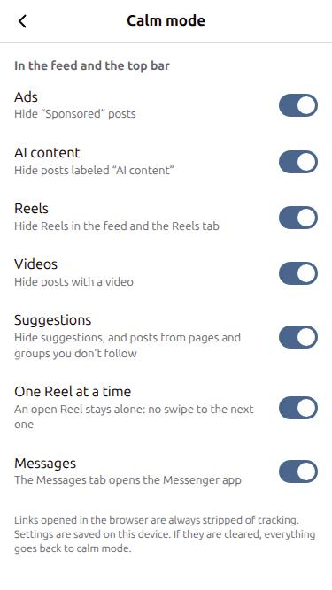

# Facebook calme

Facebook mobile (`m.facebook.com`) dans une appli Android, sans pubs, contenu IA, Reels, vidéos ni suggestions. C'est le même principe que l'appli Instagram calme, dans le dépôt [calmgram](https://github.com/eloi-del/calmgram).

## Ce que fait l'appli

Chaque filtre a son interrupteur dans Mode calme. Tous sont activés par défaut. Un post masqué fait 0px de haut, et le séparateur gris qui le suit aussi, pour éviter les bandes grises.

| Interrupteur | Comportement |
|---|---|
| Publicités | Les posts « Sponsorisé » ou « Ad » sont masqués, dans le fil et entre les vidéos du lecteur de Reels. |
| Contenu IA | Les posts marqués « Contenu IA » ou « AI content » sont masqués, dans le fil et dans le lecteur de Reels. |
| Reels | Le bloc Reels du fil est masqué, et l'icône de l'onglet Reels aussi (sa place reste blanche). `/reels/` renvoie vers le fil. Un Reel seul (`/reel/ID`) reste ouvrable. |
| Vidéos | Les posts qui contiennent une vidéo sont masqués. |
| Suggestions | Les blocs « Suggestions pour vous » sont masqués, comme les posts des pages et groupes que tu ne suis pas (ceux qui ont un bouton « Suivre » ou « Rejoindre »). |
| Un seul Reel à la fois | Dans un Reel ou une vidéo ouverts en plein écran, le swipe vers le suivant est bloqué. Le lecteur est reconnu à son contenu, pas à son adresse, car il s'ouvre aussi en `/<page>/videos/<numéro>/`. Pour voir des Reels dans le fil sans pouvoir enchaîner, coupe « Reels » et garde celui-ci. |
| Messages | L'onglet Messages ouvre l'appli Messenger, au lieu de la page « Get Messenger ». |

Ces comportements sont toujours actifs, sans interrupteur :

- La barre « Ouvrir l'application » en bas de l'écran est masquée.
- Les vidéos ont une barre de progression qu'on peut glisser pour avancer ou reculer. Elle est en bas de la vidéo, à gauche du bouton son. Le lecteur de Facebook mobile n'en a pas.
- Les liens externes s'ouvrent dans ton navigateur. L'appli enlève le passage par `l.facebook.com` et les paramètres de pistage (`fbclid`, `utm_*`, `gclid`, `mc_eid`…).
- Le scroll ne recule pas : l'ancrage de scroll est coupé sur le fil, comme pour Instagram.
- Le script ne cherche la barre « Ouvrir l'application » qu'une fois par seconde au plus. Chaque recherche coûte environ 35 ms, et la faire à chaque changement de la page rendait le scroll saccadé.
- Quand beaucoup de posts sont masqués, le fil met plus de temps à se remplir. Sur un vrai compte, environ 9 posts sur 10 étaient des pubs, des vidéos, des Reels ou des suggestions : Facebook doit en charger beaucoup pour en montrer quelques-uns.
- La recherche, les notifications, les groupes et Marketplace ne changent pas.




Le panneau Mode calme s'affiche en anglais quand la page est en anglais, et en français sinon.

## Réglages

- **Dans Facebook :** Menu (☰ en haut à droite). Le bouton **Mode calme** est en bas à droite. C'est un bouton posé par-dessus la page, et non une ligne de la liste : Facebook redessine sans arrêt ses listes, donc une ligne ajoutée dedans ne tenait pas.
- **Raccourci :** appui long sur l'icône → **Mode calme**.
- L'appli s'appelle « Facebook » sur le téléphone. Son paquet est `fr.perso.calmbook`, et son icône est à elle (trois lignes blanches sur fond bleu-gris).
- Les réglages sont gardés dans le stockage du site, sur le téléphone. S'ils sont effacés, tout revient en mode calme.

## Ce qu'il y a dedans

- `app/src/main/assets/calmbook.js` contient toutes les règles de la page. C'est le fichier à corriger quand Facebook change.
- `app/src/main/java/fr/perso/calmbook/MainActivity.kt` gère la WebView.
- `app/src/main/java/fr/perso/calmbook/LinkCleaner.kt` nettoie les liens.

**Ce qui ne marche pas pareil qu'Instagram :**

- Les posts du fil ne sont pas des `<article>`. Ce sont des blocs `[data-tracking-duration-id]`.
- Facebook vide les blocs loin de l'écran. Un post est donc classé dès qu'il se remplit, et sa marque reste sur le bloc.

**Ton identifiant :** la page de connexion est celle de Facebook. Il n'existe aucun pont entre la page et l'appli (`addJavascriptInterface` n'est pas utilisé), donc l'appli ne peut pas lire ce que tu tapes. `calmbook.js` lit seulement l'adresse de la page, l'en-tête des posts du fil et ses propres réglages. L'appli ne regarde que les adresses que la page veut ouvrir. La seule adresse spéciale est `calmbook://messenger`, qui ouvre Messenger.

**Vie privée :**

- La seule permission est Internet : ni micro, ni caméra, ni position, ni contacts.
- Les cookies d'autres sites sont refusés dans la page.
- Ta session Facebook reste dans l'appli. Ton navigateur ne l'a pas, donc les « pixels » Facebook des autres sites ne peuvent pas relier tes visites à ton compte, sauf si tu te connectes à Facebook dans le navigateur.
- Les envois de statistiques internes de Facebook (temps passé sur un post, etc.) ne sont **pas** bloqués. Un client qui ne les envoie pas serait facile à repérer.

## Compiler et installer

Les prérequis sont les mêmes que pour l'appli Instagram : Java 17, le SDK Android et `local.properties`. Avec le téléphone branché et le débogage USB autorisé, lance :

```bash
./install.sh
```

Après une compilation, Gradle reste en mémoire en arrière-plan. Sur un ordinateur qui a peu de RAM, arrête-le :

```bash
./gradlew --stop
```

Pour ouvrir directement Mode calme, lance :

```bash
./install.sh reglages
```


## Crédits

Aucun code n'a été copié. Ces projets ont servi d'inspiration :

- [Nora](https://github.com/nonbili/Nora) : repérer les pubs par l'étiquette placée sous le nom de l'auteur, et masquer la barre « Ouvrir l'application ».
- [FB-Mobile-Clean-my-feeds](https://github.com/webdevsk/FB-Mobile-Clean-my-feeds) : la liste des filtres (suggestions, pubs, Reels), et l'avertissement sur les sauts de scroll de Facebook mobile.
- [calmgram](https://github.com/eloi-del/calmgram), l'appli Instagram du même principe, sert de base à celle-ci.

## Avertissement

Projet personnel, sans lien avec Meta, qui n'a ni approuvé ni vérifié ce projet. Instagram et Facebook sont des marques de Meta. L'appli affiche le site web officiel et y ajoute seulement des règles d'affichage. Elle ne modifie pas l'appli officielle, ne lit pas ton identifiant et n'envoie rien ailleurs. Utilise-la à tes risques, dans le respect des conditions d'utilisation de Meta.

## Licence

MIT : voir [LICENSE](LICENSE).
